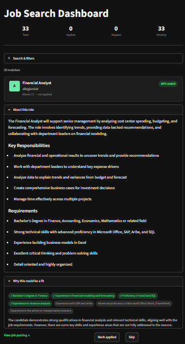

# Job Search Agent

An automated pipeline that sources job postings, scores them against my resume, and checks its own scoring before saving results. It runs every weekday without manual steps, and I make the final decision on which jobs to apply to.

**Live dashboard:** [bruno-job-search-agent.streamlit.app](https://bruno-job-search-agent.streamlit.app/)



## How it works

```
Sourcing  ->  Scoring  ->  Review  ->  Postgres (Neon)  ->  Streamlit dashboard
```

1. **Sourcing.** Pulls live postings from company job boards: Greenhouse and Lever public APIs, plus Workday's internal careers API. Postings are filtered by title and US location before any LLM call.
2. **Scoring.** An LLM compares the resume to each posting and returns a fit score, matched qualifications, skill gaps, and resume suggestions.
3. **Review.** A second LLM call checks the scoring against fixed criteria: grounded in the actual text, specific rather than generic, and internally consistent. If the check fails, scoring runs once more with the feedback.
4. **Storage and dashboard.** Results go to Postgres. The Streamlit app filters by score or location and tracks which jobs I've applied to.

The pipeline runs on a schedule through GitHub Actions.

## Design decisions

- **Two-step scoring and review.** A single LLM call can produce a reasonable-sounding assessment that isn't grounded in the resume or posting. The review step catches weak output before it reaches the database.
- **Smaller model for both steps.** Scoring and review use `gpt-4o-mini` to keep token usage low. A larger model uses more tokens per call, and for this task the output quality was close enough to justify the smaller one.
- **Filter before scoring.** Title and location filters run first, so irrelevant postings never reach the LLM. This keeps token costs down.
- **Targets in one place.** Target titles, excluded titles and company lists live in `src/sources.py`. Location rules and the resume path are set in the code, so they need editing too (see below).

## Status

**Working:** Greenhouse and Lever sourcing, one Workday integration, scoring, review, location filtering, the dashboard, and daily automation.

**Limited:** Workday coverage is one company (Eli Lilly, the only entry in `WORKDAY_COMPANIES`). Each new company needs its Workday server and tenant details found by hand, because no public directory maps companies to their Workday setup.

**Not built yet:** choosing between multiple resume versions based on the posting, and an agent that suggests new companies to add.

## Make it your own

The resume in `data/resume.pdf` is an older version of mine, included as an example. To run the pipeline for yourself:

1. **Resume.** Replace `data/resume.pdf` with your own PDF. The path is set in `RESUME_PATH` in `src/main.py`.
2. **Target roles.** Edit `TARGET_TITLE_KEYWORDS` and `EXCLUDED_TITLE_SIGNALS` in `src/sources.py`. Keywords are case-insensitive substring matches, so check that a keyword doesn't match titles you don't want.
3. **Companies.** Edit `GREENHOUSE_COMPANIES` and `LEVER_COMPANIES` in `src/sources.py`, using each company's board slug. Workday companies need a tenant, site and server, which are described in the `fetch_workday_postings` docstring.
4. **Locations.** `EXCLUDED_LOCATIONS` and `is_us_or_remote()` in `src/sources.py` decide which postings are kept. Change them for a different country or to allow specific cities.
5. **Accounts.** Create your own Postgres database (I use Neon) and an OpenAI API key. Set them in `.env` locally and as repository secrets for GitHub Actions. The tables are created automatically by `init_db()` in `src/db.py` the first time the pipeline runs.

## Run it locally

Requires Python 3.11+, a Postgres database, and an OpenAI API key.

```bash
pip install -r requirements.txt
```

Create a `.env` file in the project root. Do not commit it.

```
OPENAI_API_KEY=your_key
DATABASE_URL=your_postgres_connection_string
```

Run the pipeline:

```bash
python src/main.py
```

Run the dashboard:

```bash
cd dashboard
streamlit run app.py
```

Company sources are configured in `src/sources.py`. The current list has six companies: Agoda, Esri and Justworks (Greenhouse), Allegiant Air and Rover (Lever), and Eli Lilly (Workday).

## Automation setup

The workflow in `.github/workflows/run-pipeline.yml` runs weekdays at 13:00 UTC. Add two repository secrets under **Settings > Secrets and variables > Actions**: `OPENAI_API_KEY` and `DATABASE_URL`.

## Tech

Python, OpenAI API (`gpt-4o-mini`), PostgreSQL on Neon, Streamlit, GitHub Actions. Sources: Greenhouse, Lever and Workday public endpoints.
